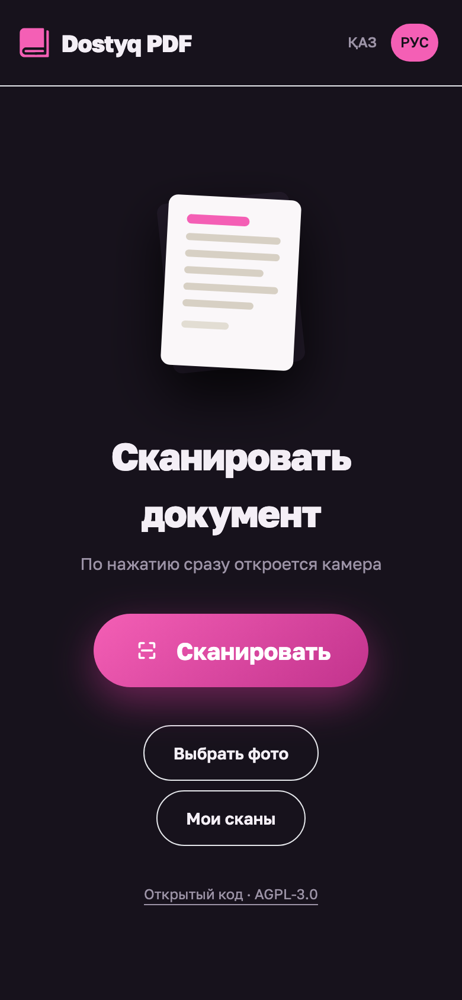
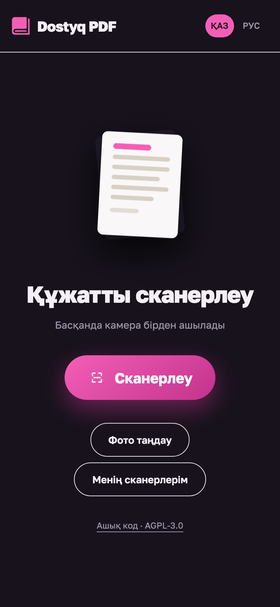
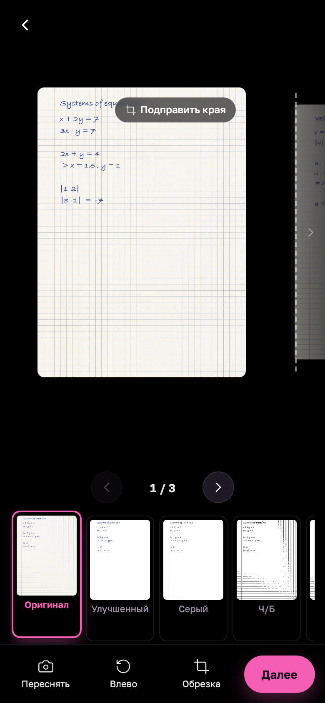
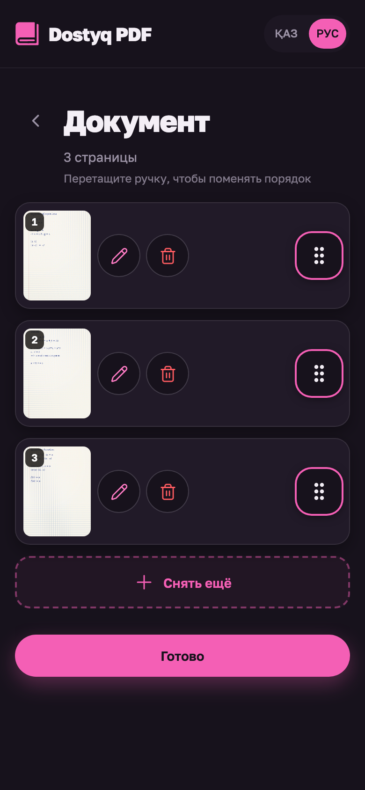
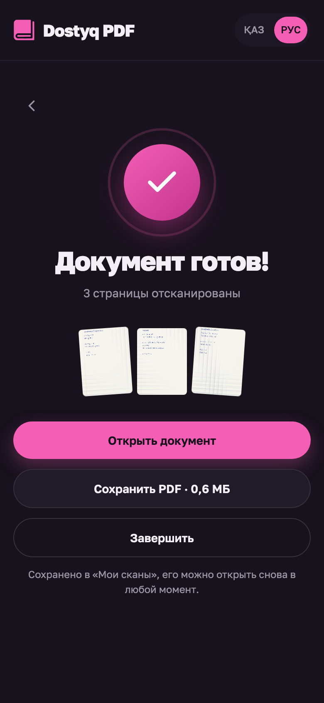

# Dostyq PDF

**Фото конспекта → один лёгкий PDF. Бесплатно, без рекламы, без регистрации. Фото не уходят с телефона.**

Ученик выбирает фотографии тетради, расставляет страницы по порядку, при необходимости
поворачивает и обрезает, проверяет превью и получает готовый PDF — чтобы загрузить его
конспектом на платформу Dostyq одним файлом вместо десятка тяжёлых фото.

<table>
  <tr>
    <td align="center"></td>
    <td align="center"></td>
    <td align="center"></td>
    <td align="center"></td>
    <td align="center"></td>
  </tr>
</table>

> **Статус: ранняя версия (0.1.0).** Основные функции работают и проверены на 40 реальных
> фото с телефона. Это форк [Nitidoc](https://github.com/santiagoisra/nitidoc) с доработками
> под школьников. Что уже есть, а что ещё нет — в разделе [«Что готово»](#что-готово).
> Сайт работает по временному адресу: **https://dostyq-pdf.pages.dev** (Cloudflare Pages).

*In English:* Dostyq PDF is an ad-free, account-free, fully client-side PWA that turns photos of
handwritten notes into one compressed PDF (40 phone photos, 257 MB, become about 11 MB). It is a
fork of [Nitidoc](https://github.com/santiagoisra/nitidoc) (AGPL-3.0-or-later) adapted for school
students: Kazakh/Russian UI, Dostyq branding and PDF size reduction. Early version, live at https://dostyq-pdf.pages.dev.

---

## Зачем это нужно

Конспекты на платформу грузят фотографиями с телефона. Фото 12 Мп весит 6–8 МБ, а платформа
принимает не больше 20 МБ за отправку. Упаковка в PDF сама по себе вес не уменьшает. Нужно
**сначала уменьшить фото, потом упаковать в PDF**. Готового бесплатного инструмента без рекламы
и с минимальным набором функций не нашлось, поэтому взяли открытую основу и доработали её.

## Как это работает

1. Выбрать несколько фото из галереи или снять камерой прямо в приложении.
2. Приложение ищет лист на фото, выпрямляет его и при необходимости применяет фильтр
   (например, чёрно-белый, чтобы текст читался лучше). Если лист плохо виден на фоне, края
   можно подправить вручную.
3. Страницы можно переставить перетаскиванием, повернуть, удалить.
4. Превью каждой страницы: проверить, что всё читается.
5. Приложение собирает PDF, показывает его размер на кнопке («Сохранить PDF · 5,6 МБ») и
   сохраняет файл на телефон.

Всё считается **в браузере на устройстве**. Сервера, куда отправлялись бы фото, нет: это
архитектура, а не обещание. Проверить можно во вкладке Network браузера.

## Размер PDF

Страница в PDF не больше 2000 px по длинной стороне, JPEG качеством 0,75. Параметры подобраны
замером на 40 реальных фото Xiaomi 13 Ultra (4096×3072, 6–8 МБ каждое): тетрадь в клетку
ручкой, учебник, доска. Читаемость проверена при двукратном увеличении.

| | Фото | PDF без сжатия | PDF сейчас |
|---|---|---|---|
| учебник, 21 страница | 134 МБ | 25,8 МБ | **5,9 МБ** |
| тетрадь и доска, 19 страниц | 123 МБ | 22,8 МБ | **5,2 МБ** |

Платформа принимает файлы до 20 МБ; если PDF получился больше, приложение предупреждает об
этом до сохранения. В одном документе сейчас до 30 страниц.

## Приватность

- Фото **не покидают устройство**: нет сервера, куда их можно отправить.
- Документы хранятся только на устройстве (в «Мои сканы»), их можно удалить.
- Необязательный счётчик посещений (Cloudflare Web Analytics, без cookies) **выключен по
  умолчанию**. Он включается только если при сборке задан `VITE_CF_ANALYTICS_TOKEN`; без токена
  в сборке нет ни кода счётчика, ни обращений к чужим серверам. Это проверяется при каждой сборке.

## Что готово

Из Nitidoc (по README и коду оригинала; его тесты проходят, e2e-тесты проходят):

- [x] Импорт нескольких фото за раз; съёмка камерой
- [x] Порядок перетаскиванием, удаление, поворот (вручную, по одной странице)
- [x] Автоматический поиск листа, ручная правка углов, выпрямление перспективы
- [x] Фильтры: оригинал, улучшенный, серый, ч/б, ч/б с контрастом, эко
- [x] PDF без водяных знаков
- [x] PWA: ставится на главный экран, работает офлайн
- [x] Всё локально, без аккаунта и без сервера

Наши доработки:

- [x] **Сжатие при сборке PDF**: 40 фото (257 МБ) → ~11 МБ вместо ~49 МБ без сжатия
- [x] Показ итогового веса PDF до сохранения и предупреждение, если он больше лимита платформы (20 МБ)
- [x] Интерфейс на қазақша и русском (в оригинале испанский и английский). Казахский текст — черновик, ждёт вычитки носителем языка
- [x] Фирменный стиль Dostyq: цвета и тёмная тема платформы, шрифт Golos Text (есть все казахские буквы), логотип и иконки
- [x] Убрано лишнее: Firebase, Android-обёртка, лендинг оригинала
- [x] Необязательный счётчик посещений без cookies (по умолчанию выключен)
- [ ] Проверить на iPhone, как сохраняется PDF, и при необходимости добавить «Поделиться»
- [ ] Проверить на недорогом Android: память при 20–30 фото по 12 Мп
- [x] Сайт опубликован на Cloudflare Pages (временный адрес `dostyq-pdf.pages.dev`; свой поддомен позже)

Чего не будет: аккаунтов, рекламы, хранения чужих файлов, автоповорота страниц (ученик сам
поворачивает страницы, которые лежат боком).

## Запуск у себя

Нужны **Node.js 22+** и **npm 10+**.

```bash
npm ci
npm run build
npm run preview
```

Откройте адрес, который напечатает команда (по умолчанию `http://localhost:4173`).

> **Почему `build` + `preview`, а не `npm run dev`.** OpenCV.js работает только в «классическом»
> Web Worker и в режиме `dev` не поднимается. В `dev` остаются доступны импорт фото и ручные
> углы, а автоматический поиск листа и фильтры — нет. Для полной проверки собирайте проект.

Другие команды:

| Команда | Что делает |
| --- | --- |
| `npm test` | Юнит-тесты (Vitest), сейчас 528 |
| `npm run typecheck` | Проверка типов |
| `npm run test:e2e` | Сквозные тесты (Playwright; сначала `npx playwright install chromium webkit`) |
| `python3 scripts/make_icons.py` | Пересобрать иконки приложения из `public/icons/logo-mark.svg` |

Настройка сборки (необязательная): скопируйте `.env.example` в `.env.production`.

## Как устроено

React 18 · TypeScript (strict) · Vite · Zustand · Tailwind CSS · OpenCV.js (WebAssembly, в
Web Worker) · jsPDF · dnd-kit · Vitest · Playwright.

- Правки (углы, поворот, фильтр) хранятся отдельно от исходных фото и применяются при
  отображении и экспорте. Поэтому всё можно отменить и пересобрать заново.
- Поиск листа, выпрямление и фильтры работают в отдельном потоке и не вешают интерфейс.
- OpenCV.js весит ~10 МБ (около 3,2 МБ по сети со сжатием, замер на Cloudflare Pages). Он не
  лежит в основном бандле, загружается отдельно и дальше берётся из кэша.
- PDF собирается в фоне, пока открыт экран «готово»: размер известен до сохранения, а само
  сохранение мгновенное.

Подробности об исходной архитектуре — в [оригинальном README Nitidoc](docs/NITIDOC_README.md).
Как выложить сайт — в [docs/DEPLOY.md](docs/DEPLOY.md). Как вносить правки, в том числе в
переводы, — в [CONTRIBUTING.md](CONTRIBUTING.md).

## Лицензия и происхождение

Dostyq PDF — **форк [Nitidoc](https://github.com/santiagoisra/nitidoc)** автора
[santiagoisra](https://github.com/santiagoisra). Вся основная работа (поиск листа, выпрямление,
фильтры, PWA, тесты) принадлежит ему. Наши изменения здесь — перевод, фирменный стиль,
сжатие PDF, показ размера и чистка от лишнего.

Проект распространяется под
**[GNU Affero General Public License v3.0 или новее](LICENSE)** — той же лицензией, что и
оригинал. Это значит:

- код можно использовать, изучать, менять и распространять;
- если вы запускаете изменённую версию для других людей по сети, нужно предложить им её
  исходный код. Поэтому в приложении есть ссылка «Открытый код» на этот репозиторий;
- уведомления об авторстве и текст лицензии сохраняются.

**Название и логотип Dostyq** — фирменные знаки Dostyq. Лицензия AGPL относится к коду, но не даёт прав
использовать эти знаки в чужих продуктах. Логотип лежит в `public/icons/logo-mark.svg`, иконки приложения
собираются из него скриптом `scripts/make_icons.py`. Шрифт Golos Text распространяется по лицензии
SIL OFL 1.1 (`public/fonts/GolosText-OFL.txt`).

Что именно мы изменили относительно оригинала, видно в истории коммитов: она сохранена
полностью, включая коммиты автора Nitidoc.
